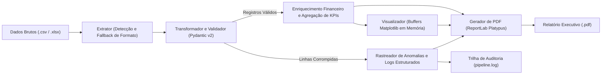

# Pipeline de Automação ETL e Motor de Relatórios Executivos em PDF

<p align="left">
  <b>Português Brasileiro 🇧🇷</b> | <a href="README_en.md">English 🇺🇸</a>
</p>

[](https://www.python.org/)
[](https://docs.pydantic.dev/)
[](https://pandas.pydata.org/)
[](https://www.reportlab.com/)
[](https://docs.pytest.org/)
[]()

Pipeline modular em Python pronto para produção, projetado para ingestão de dados corporativos, validação estrita de esquemas, detecção de anomalias de negócio, enriquecimento de métricas e geração automatizada de relatórios executivos em PDF com alta qualidade visual.

---

## Visão Geral Executiva e Definição do Problema

Em ambientes corporativos, dados tabulares brutos (`.csv`, `.xlsx`) oriundos de sistemas legados, integrações externas ou pontos de venda frequentemente contêm inconsistências silenciosas: datas mal formatadas, categorias não homologadas, preços unitários negativos e descontos acima das diretrizes comerciais. Scripts ETL tradicionais costumam quebrar inesperadamente ou propagar métricas corrompidas para dashboards executivos.

Este projeto entrega uma **solução de automação ETL resiliente e tolerante a falhas**:

- **Contratos de Dados Estritos:** Validação rigorosa com **Pydantic v2** para garantir restrições de esquema e regras invariantes de negócio na fronteira de ingestão.
- **Isolamento e Resiliência:** Registros corrompidos são isolados como anomalias estruturadas e auditados em log de telemetria, permitindo que as linhas válidas continuem o processamento sem interrupção.
- **Analytics Visual em Memória:** Gráficos corporativos gerados via **Matplotlib** em backend headless (*Agg*), sem dependências gráficas de interface e sem sobrecarga de I/O em disco.
- **Síntese de Relatório Executivo em PDF:** Gera um documento profissional via **ReportLab Platypus**, com cartões de KPI, matriz zebrada, visualizações gráficas e tabela de auditoria de governança de dados.

---

## Arquitetura e Fluxo de Dados



---

## Estrutura de Pastas

```text
etl_report_pipeline/
│
├── data/
│   ├── raw/                  # Arquivos de entrada brutos (.csv, .xlsx)
│   └── processed/            # Relatórios executivos em PDF gerados
├── src/
│   ├── __init__.py
│   ├── config.py             # Tokens de design, paleta de cores, caminhos e regras
│   ├── schemas.py            # Modelos Pydantic v2 (TransactionRecord, AnomalyRecord)
│   ├── extractor.py          # Ingestão de múltiplos formatos com fallback de encoding
│   ├── transformer.py        # Validação de regras, enriquecimento e consolidação de KPIs
│   ├── visualizer.py         # Gráficos corporativos em buffers de memória
│   ├── pdf_generator.py      # Construtor ReportLab Platypus com rodapés NumberedCanvas
│   └── logger.py             # Logging centralizado (console + pipeline.log)
├── tests/
│   ├── __init__.py
│   ├── test_extractor.py     # Testes de extração e tratamento de exceções
│   ├── test_schemas.py       # Testes de validação de esquemas e limites de negócio
│   ├── test_transformer.py   # Testes de enriquecimento e segregação de anomalias
│   └── test_pdf_generator.py # Testes de integração de renderização e layout do PDF
├── main.py                   # Ponto de entrada CLI (argparse e gerador de massa de testes)
├── requirements.txt          # Manifesto de dependências congeladas
├── README.md                 # Documentação em Português Brasileiro
└── README_en.md              # Documentação em Inglês
```

---

## Início Rápido

### 1. Pré-requisitos e Ambiente Virtual

Certifique-se de possuir o Python 3.11 ou superior instalado:

```bash
# Navegue até a raiz do projeto
cd etl_report_pipeline

# Crie o ambiente virtual
python -m venv .venv

# Ative o ambiente virtual (Windows PowerShell)
.venv\Scripts\activate

# Ative o ambiente virtual (Linux/macOS)
source .venv/bin/activate

# Instale as dependências
pip install -r requirements.txt
```

### 2. Gerar Massa de Dados para Testes

Caso não possua arquivos brutos prontos, utilize o gerador embutido para criar arquivos em `data/raw/` contendo registros comerciais válidos e anomalias propositais:

```bash
python main.py --generate-sample
```

### 3. Executar o Pipeline

Execute o pipeline de ponta a ponta:

```bash
python main.py
```

Ou especifique um arquivo bruto de entrada e o caminho de saída do PDF:

```bash
python main.py -i data/raw/sample_sales.xlsx -o data/processed/auditoria_executiva.pdf
```

---

## Recursos do Relatório Executivo em PDF

O documento gerado foi estruturado para apresentação direta a níveis de diretoria/C-level:

- **Cabeçalho com Telemetria:** Indicador dinâmico de qualidade dos dados (`● QUALITY SCORE: 70.6%`), data/hora de execução e status verificado.
- **Cartões de KPI (Summary Cards):** Receita Líquida, Volume de Unidades Vendidas, Ticket Médio (AOV) e Taxa de Ingestão de Linhas Válidas.
- **Gráficos em Alta Resolução (300 DPI):**
  - Receita Líquida por Categoria de Produto (Gráfico de barras horizontais com anotação monetária).
  - Participação Regional na Receita (Gráfico de Rosca/Donut).
  - Trajetória Temporal de Vendas (Linha suavizada com preenchimento translúcido).
- **Matriz Comercial Zebrada:** Tabela detalhada por categoria com formatação monetária, contagem de unidades e cálculo de percentual de representatividade.
- **Auditoria de Governança e Anomalias:** Tabela de diagnósticos apontando a linha exata, ID da transação, campo inválido, motivo da recusa e valor bruto recebido.
- **Rodapé Dinâmico em Dois Passos:** Numeração contínua de páginas (`Página X de Y`) e notas de confidencialidade via `NumberedCanvas`.

---

## Regras de Negócio e Detecção de Anomalias

| Campo / Regra | Restrição | Ação em Caso de Violação |
| :--- | :--- | :--- |
| `region` | Deve pertencer a `{North, South, East, West, Central}` | Isolado como anomalia, excluído dos KPIs |
| `units_sold` | Deve ser número inteiro `> 0` | Isolado como anomalia |
| `unit_price` | Deve ser número decimal `> 0.0` | Isolado como anomalia |
| `discount_pct` | Teto de política comercial: `≤ 70.0%` | Isolado como anomalia |
| `date` | Formato válido ISO (`YYYY-MM-DD`) ou padrão barra (`DD/MM/YYYY`) | Isolado como anomalia |
| `payment_status` | Deve pertencer a `{Completed, Pending, Cancelled, Refunded}` | Isolado como anomalia |

---

## Testes e Qualidade de Código

A suíte de testes contempla cenários positivos, casos extremos, dataframes corrompidos e integridade de arquivo binário:

```bash
pytest -v
```

Saída:

```text
tests/test_extractor.py::test_extract_csv PASSED
tests/test_extractor.py::test_extract_excel PASSED
tests/test_extractor.py::test_extract_non_existent_file PASSED
tests/test_extractor.py::test_extract_unsupported_format PASSED
tests/test_extractor.py::test_extract_empty_file PASSED
tests/test_pdf_generator.py::test_build_pdf_report_generates_valid_file PASSED
tests/test_pdf_generator.py::test_pdf_report_without_anomalies PASSED
tests/test_schemas.py::test_valid_transaction_record PASSED
tests/test_schemas.py::test_schema_normalizes_case_and_dates PASSED
tests/test_schemas.py::test_invalid_region_raises_validation_error PASSED
tests/test_schemas.py::test_excessive_discount_rejected PASSED
tests/test_schemas.py::test_negative_or_zero_units_sold_rejected PASSED
tests/test_schemas.py::test_negative_unit_price_rejected PASSED
tests/test_schemas.py::test_anomaly_record_structure PASSED
tests/test_transformer.py::test_transform_valid_dataset PASSED
tests/test_transformer.py::test_transform_mixed_dataset_filters_anomalies PASSED
tests/test_transformer.py::test_all_invalid_rows_raises_value_error PASSED
tests/test_transformer.py::test_empty_dataframe_handling PASSED

============================= 18 passed in 8.22s =============================
```

---

## Licença

Licença MIT. Livre para uso comercial, educacional e inclusão em portfólio.
