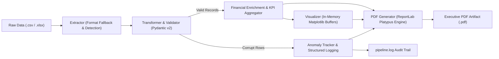

# ETL Automation Pipeline & Executive PDF Reporting Engine

**English** | [Português Brasileiro 🇧🇷](README.md)

[](https://www.python.org/)
[](https://docs.pydantic.dev/)
[](https://pandas.pydata.org/)
[](https://www.reportlab.com/)
[](https://docs.pytest.org/)


A modular, production-ready Python automation pipeline designed for corporate data ingestion, strict schema validation, business anomaly detection, data enrichment, and automated executive PDF report synthesis.

---

## 🎯 Executive Overview & Problem Statement

In enterprise environments, raw tabular data (`.csv`, `.xlsx`) coming from third-party systems, legacy databases, or point-of-sale systems frequently contains silent inconsistencies: malformed dates, invalid categories, negative unit prices, and out-of-policy discounts. Traditional ETL scripts often crash abruptly or silently propagate corrupt metrics into executive dashboards.

This project delivers a **fault-tolerant, resilient ETL automation solution**:

- **Strict Data Contracts:** Powered by **Pydantic v2** to enforce schema constraints and business invariants at the ingestion boundary.
- **Resilient Pipeline Isolation:** Corrupted records are isolated as structured anomalies, logged with telemetry diagnostics, while valid records proceed seamlessly.
- **In-Memory Visual Analytics:** Corporate charts are generated using **Matplotlib** without GUI dependencies or disk I/O bottlenecks.
- **Executive PDF Synthesis:** Generates a publication-grade PDF report featuring KPI cards, zebra-striped data matrices, visual charts, and a data governance audit table.

---

## Architecture & Data Flow



---

## Project Structure

```text
etl_report_pipeline/
│
├── data/
│   ├── raw/                  # Raw input datasets (.csv, .xlsx)
│   └── processed/            # Generated executive PDF reports
├── src/
│   ├── __init__.py
│   ├── config.py             # Design tokens, palettes, paths, and business thresholds
│   ├── schemas.py            # Pydantic v2 models (TransactionRecord, AnomalyRecord)
│   ├── extractor.py          # Multi-format ingestion with encoding fallback
│   ├── transformer.py        # Schema validation, enrichment, and KPI calculation
│   ├── visualizer.py         # Headless corporate charts rendered to memory buffers
│   ├── pdf_generator.py      # ReportLab Platypus builder with NumberedCanvas footers
│   └── logger.py             # Dual-destination logging (console + pipeline.log)
├── tests/
│   ├── __init__.py
│   ├── test_extractor.py     # Tests for file reading and exception handling
│   ├── test_schemas.py       # Tests for Pydantic schema validation & business constraints
│   ├── test_transformer.py   # Tests for data enrichment & anomaly segregation
│   └── test_pdf_generator.py # Integration tests for PDF rendering & layout
├── main.py                   # CLI entrypoint with argparse & sample generator
├── requirements.txt          # Frozen dependency manifest
├── README.md                 # Documentation in Brazilian Portuguese
└── README_en.md              # Documentation in English
```

---

## Quick Start

### 1. Prerequisites & Virtual Environment

Ensure Python 3.11 or newer is installed:

```bash
# Clone or navigate to the repository
cd etl_report_pipeline

# Create virtual environment
python -m venv .venv

# Activate environment (Windows)
.venv\Scripts\activate

# Activate environment (Linux/macOS)
source .venv/bin/activate

# Install dependencies
pip install -r requirements.txt
```

### 2. Generate Realistic Sample Data

If you do not have raw files ready, run the built-in generator to populate `data/raw/` with both valid transactions and intentional anomalies:

```bash
python main.py --generate-sample
```

### 3. Run the Pipeline

Execute the end-to-end pipeline:

```bash
python main.py
```

Or target a specific input file and custom PDF destination:

```bash
python main.py -i data/raw/sample_sales.xlsx -o data/processed/quarterly_audit.pdf
```

---

## Executive PDF Features

The generated executive document is engineered for C-level presentation:

- **Header & Telemetry Banner:** Dynamic Quality Score badge (`● QUALITY SCORE: 70.6%`), timestamp, and execution status.
- **KPI Summary Cards:** Net Revenue, Total Units Sold, Average Order Value (AOV), and Ingestion Volume.
- **High-DPI Visual Analytics:**
  - Net Revenue by Product Category (Horizontal Bar Chart with currency data labels).
  - Regional Revenue Share (Donut Chart).
  - Revenue Trajectory over Time (Smoothed line with area shading).
- **Zebra-Striped Commercial Matrix:** Category performance breakdown with currency formatting and contribution percentages.
- **Data Quality & Anomaly Audit:** Tabular log listing flagged rows, invalid fields, exact failure reasons, and raw values.
- **Two-Pass Dynamic Footers:** Numbered page footers (`Page X of Y`) and confidentiality notices via custom `NumberedCanvas`.

---

## Business Invariants & Anomaly Detection

| Rule / Field | Constraint | Action on Violation |
| :--- | :--- | :--- |
| `region` | Must belong to `{North, South, East, West, Central}` | Flagged as Anomaly, excluded from KPIs |
| `units_sold` | Must be an integer `> 0` | Flagged as Anomaly |
| `unit_price` | Must be a float `> 0.0` | Flagged as Anomaly |
| `discount_pct` | Policy cap: `≤ 70.0%` | Flagged as Anomaly |
| `date` | Must parse valid ISO (`YYYY-MM-DD`) or slash (`DD/MM/YYYY`) format | Flagged as Anomaly |
| `payment_status` | Must belong to `{Completed, Pending, Cancelled, Refunded}` | Flagged as Anomaly |

---

## Testing & Code Quality

The suite contains unit and integration tests covering positive paths, edge cases, corrupted dataframes, and binary file integrity:

```bash
pytest -v
```

Output:

```text
tests/test_extractor.py::test_extract_csv PASSED
tests/test_extractor.py::test_extract_excel PASSED
tests/test_extractor.py::test_extract_non_existent_file PASSED
tests/test_extractor.py::test_extract_unsupported_format PASSED
tests/test_extractor.py::test_extract_empty_file PASSED
tests/test_pdf_generator.py::test_build_pdf_report_generates_valid_file PASSED
tests/test_pdf_generator.py::test_pdf_report_without_anomalies PASSED
tests/test_schemas.py::test_valid_transaction_record PASSED
tests/test_schemas.py::test_schema_normalizes_case_and_dates PASSED
tests/test_schemas.py::test_invalid_region_raises_validation_error PASSED
tests/test_schemas.py::test_excessive_discount_rejected PASSED
tests/test_schemas.py::test_negative_or_zero_units_sold_rejected PASSED
tests/test_schemas.py::test_negative_unit_price_rejected PASSED
tests/test_schemas.py::test_anomaly_record_structure PASSED
tests/test_transformer.py::test_transform_valid_dataset PASSED
tests/test_transformer.py::test_transform_mixed_dataset_filters_anomalies PASSED
tests/test_transformer.py::test_all_invalid_rows_raises_value_error PASSED
tests/test_transformer.py::test_empty_dataframe_handling PASSED

============================= 18 passed in 8.22s =============================
```

---

## License

MIT License. Free for commercial and portfolio use.
